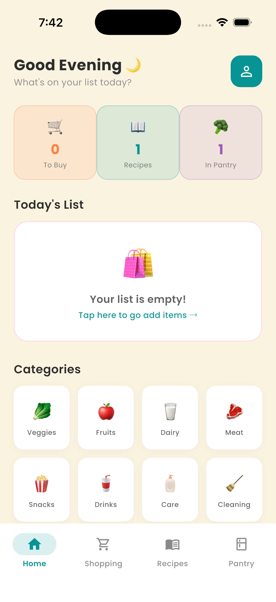
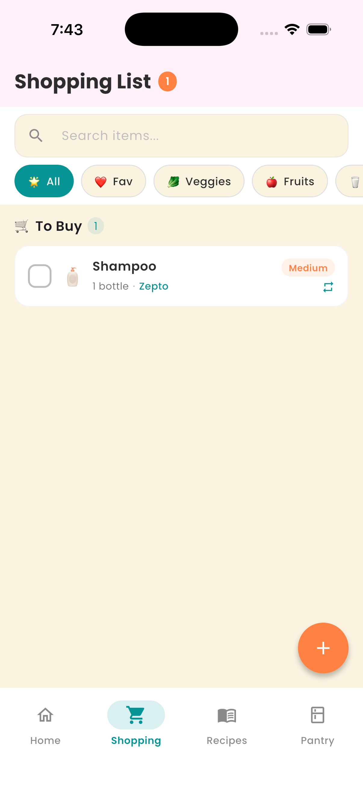
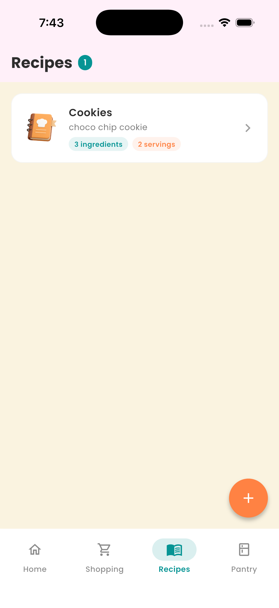
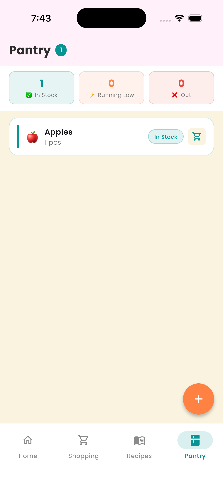

# 🥦 PantryPal

A grocery, recipe and pantry manager built with Flutter. Plan your shopping, turn recipes into shopping lists in one tap, and keep track of what's running low at home.

**🔗 Live demo:** https://kas2804.github.io/pantrypal/
<br>
**🎥 Video walkthrough:** 

https://github.com/user-attachments/assets/11d4a907-e7b6-4d5b-87cf-336adaba4404


## Screenshots

| Home | Shopping | Recipes | Pantry |
|------|----------|---------|--------|
|  |  |  |  |

## Features

**Shopping list**
- Categories with icons, quantity + unit selection, priority (High / Medium / Low)
- Buy online or in-store, store selector, notes per item
- Repeating items with custom frequency
- Favourites, "Often Bought" quick-add, live search
- Tick off bought items, swipe to delete, clear bought items

**Recipes**
- Save recipes with a custom ingredient list
- Serving-size scaler that recalculates quantities
- One tap to add all ingredients to the shopping list

**Pantry**
- Track stock status: In Stock / Running Low / Out of Stock
- Tap a badge to cycle status, one-tap add to shopping list
- Low-stock alert on the Home dashboard

**Other**
- Home dashboard with live stats and today's list
- English / Hindi language toggle (partial localization)
- All data saved locally on the device (offline-first)

## Tech stack

- **Flutter / Dart**
- **Riverpod** for state management
- **Hive** for local persistence
- **flutter_slidable**, **google_fonts**, **uuid**

## Architecture

```
lib/
├── constants/   # colours, app constants, localized strings
├── models/      # ShoppingItem, Recipe, PantryItem
├── providers/   # Riverpod notifiers (state + Hive storage)
├── screens/     # home, shopping, recipes, pantry, settings
├── widgets/     # reusable UI (item card)
└── theme/       # app theme
```

Each feature follows the same pattern: **Model → StateNotifier + Hive → Screens**.

## Run locally

```bash
git clone https://github.com/YOUR-USERNAME/pantrypal.git
cd pantrypal
flutter pub get
flutter run
```

## Roadmap

- [ ] Complete Hindi localization
- [ ] Dark mode redesign
- [ ] Cloud sync (Firebase) to share lists with family
- [ ] Share recipes
- [ ] Home screen widget
